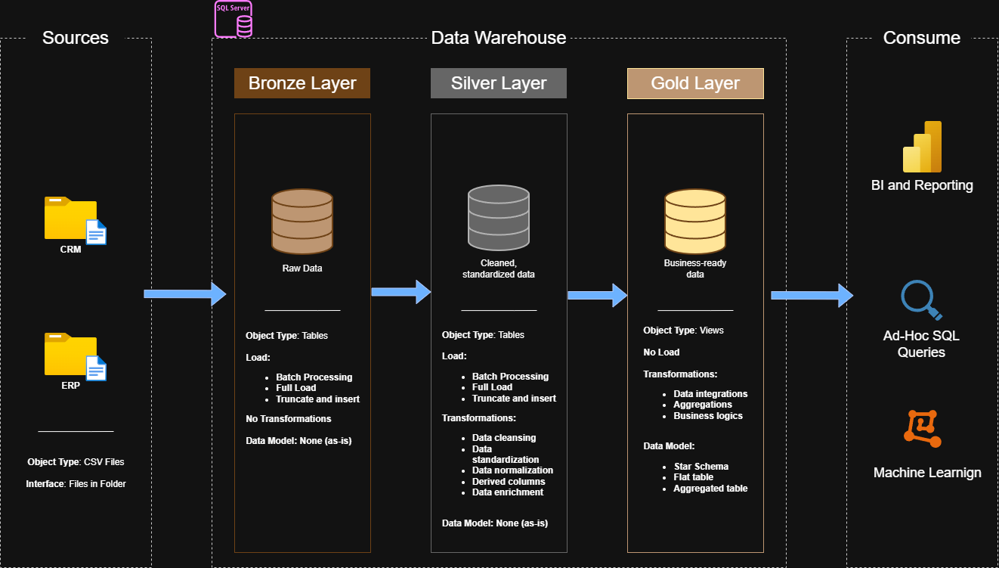
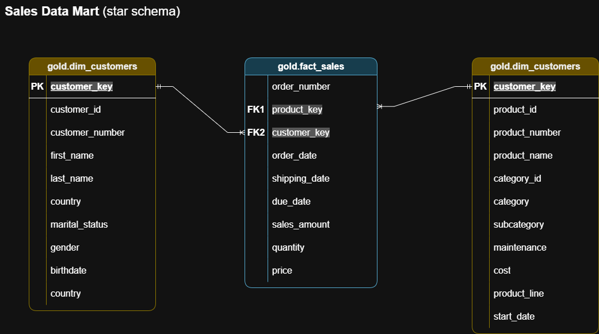

# 🏗️ Data Warehouse & Analytics Project

Welcome to my **Data Warehouse & Analytics Project!**

This project focuses on building an end-to-end data warehousing and analytics solution using Microsoft SQL Server. It involves integrating data from ERP and CRM systems, transforming raw datasets into structured, business-ready information, and performing SQL-based analysis to uncover meaningful insights.

Through this project, I'm developing practical skills in **data engineering, ETL development, dimensional modeling, and SQL analytics**, while applying concepts used in modern data warehouse environments.

---

## 📑 Table of Contents

- [Tech Stack](#tech-stack)
- [Project Requirements](#project-requirements)
- [Data Architecture](#data-architecture)
- [ETL Pipeline](#etl-pipeline)
- [Data Model](#data-model)
- [Project Structure](#project-structure)
- [Key Project Files](#key-project-files)
- [Data Quality & Testing](#data-quality-testing)
- [About Me](#about-me)
- [License](#license)

---

<a id="tech-stack"></a>
## 🛠️ Tech Stack

- **Database:** Microsoft SQL Server
- **SQL Development:** SQL Server Management Studio (SSMS)
- **Programming Language:** T-SQL
- **Data Integration:** ETL (Extract, Transform, Load)
- **Data Architecture:** Medallion Architecture (Bronze, Silver, Gold)
- **Data Modeling:** Star Schema
- **Version Control:** Git & GitHub

---

<a id="project-requirements"></a>
## 📋 Project Requirements

### Building the Data Warehouse (Data Engineering)

#### Objective

Build a centralized data warehouse using SQL Server that integrates sales data from multiple sources, creating a structured and reliable foundation for reporting and analysis.

#### Specifications

- **Data Sources:** Extract and import data from two systems (ERP and CRM) provided as CSV files.
- **Data Quality:** Identify and resolve data inconsistencies, missing values, and other quality issues to improve data reliability.
- **Integration:** Consolidate data from both sources into a unified data model optimized for analysis and reporting.
- **Scope:** Focus on the latest dataset only; historization of data is not required.
- **Documentation:** Provide clear documentation of the data model to support both business stakeholders and analytics teams.

### BI: Analytics & Reporting (Data Analytics)

#### Objective

Use SQL queries to analyze the data warehouse and uncover insights that can help businesses better understand their performance.

The analysis focuses on three key areas:

- **Customer Behavior:** Explore customer purchasing patterns and trends.
- **Product Performance:** Evaluate product sales and identify top-performing products.
- **Sales Trends:** Analyze sales performance over time to identify patterns and opportunities.

These insights provide stakeholders with valuable business metrics to support data-driven decision-making.

---

<a id="data-architecture"></a>
## 🏗️ Data Architecture

This project follows the **Medallion Architecture**, organizing data into three layers: Bronze, Silver, and Gold.

Each layer plays a specific role in transforming raw data into structured, business-ready information.

### Architecture Overview



### 🔗 Additional Architecture Documentation


- 📊 [Data Flow Diagram](https://github.com/khanfarazwk/sql-data-warehouse-project/blob/main/docs/Data%20Flow%20Diagram.drawio.png)
- 🔗 [Data Integration Model](https://github.com/khanfarazwk/sql-data-warehouse-project/blob/main/docs/Integration%20Model.drawio.png)
- 🗃️ [Gold Layer Data Model](docs/data_model.drawio.png)
- 📖 [Data Dictionary](docs/data_catalog.md)

---

<a id="etl-pipeline"></a>
## 🔄 ETL Pipeline

The data pipeline is organized into three layers, each responsible for a specific stage of data processing.

### Bronze Layer — Data Ingestion

- Import raw CSV files from ERP and CRM systems.
- Preserve the original data without transformations.
- Store the data in the Bronze schema.

### Silver Layer — Data Cleaning & Transformation

- Identify and handle missing or inconsistent values.
- Standardize data formats and naming conventions.
- Remove duplicate records where appropriate.
- Prepare clean, consistent datasets for downstream processing.

### Gold Layer — Business-Ready Data

- Transform cleaned data into fact and dimension tables.
- Create relationships between sales, customers, and products.
- Structure the data using a Star Schema.
- Prepare datasets for analytical queries and reporting.

---

<a id="data-model"></a>
## 🗃️ Data Model

The Gold Layer follows a **Star Schema** designed to support analytical reporting and business intelligence.

The data model consists of one fact table and two dimension tables:

- **gold.fact_sales:** Stores sales transactions, including order details, quantities, and sales amounts.
- **gold.dim_customers:** Contains customer information, including demographic and geographic attributes.
- **gold.dim_products:** Stores product details, categories, and pricing information.

### Star Schema Diagram



For detailed information about each table and its columns, refer to the [Gold Layer Data Dictionary](docs/data_catalog.md).

---

<a id="project-structure"></a>
## 📂 Project Structure

The repository is organized into separate folders for datasets, documentation, SQL scripts, and data quality testing.

```text
sql-data-warehouse-project/
│
├── datasets/                         # Source data files
│
├── docs/                             # Project documentation
│   ├── Architecture.drawio
│   ├── Architecture.drawio.png
│   ├── Data Flow Diagram.drawio.png
│   ├── Integration Model.drawio.png
│   ├── data_catalog.md               # Gold Layer data dictionary
│   ├── data_model.drawio
│   └── data_model.drawio.png
│
├── scripts/                          # SQL development scripts
│   ├── bronze/
│   │   ├── ddl_bronze.SQL            # Bronze table definitions
│   │   └── proc_load_bronze.sql      # Bronze data loading procedure
│   │
│   ├── gold/
│   │   └── ddl_gold.sql              # Gold Layer table/view definitions
│   │
│   ├── silver/                       # Silver Layer SQL scripts
│   │
│   └── init_database.sql             # Database initialization
│
├── tests/                            # Data quality testing
│   ├── quality_checks_gold.sql       # Gold Layer validation
│   └── quality_checks_silver.sql     # Silver Layer validation
│
├── LICENSE                           # Project license
└── README.md                         # Project overview
```

<a id="key-project-files"></a>
### 🔗 Key Project Files

**Documentation**

- [Data Warehouse Architecture](docs/Architecture.drawio.png)
- [Data Flow Diagram](docs/Data%20Flow%20Diagram.drawio.png)
- [Integration Model](docs/Integration%20Model.drawio.png)
- [Star Schema Diagram](docs/data_model.drawio.png)
- [Gold Layer Data Dictionary](docs/data_catalog.md)

**SQL Scripts**

- [Database Initialization](scripts/init_database.sql)
- [Bronze Layer Table Definitions](scripts/bronze/ddl_bronze.SQL)
- [Bronze Layer Loading Procedure](scripts/bronze/proc_load_bronze.sql)
- [Gold Layer Definitions](scripts/gold/ddl_gold.sql)

**Data Quality Testing**

- [Silver Layer Quality Checks](tests/quality_checks_silver.sql)
- [Gold Layer Quality Checks](tests/quality_checks_gold.sql)

---

<a id="data-quality-testing"></a>
## ✅ Data Quality & Testing

Data quality checks are included to help validate data consistency, accuracy, and reliability throughout the data pipeline.

Testing is organized into two areas:

### Silver Layer Validation

The Silver Layer testing scripts are used to validate the cleaned and transformed datasets before they are used for analytical modeling.

### Gold Layer Validation

The Gold Layer testing scripts are used to validate the business-ready datasets and support reliable analytical reporting.

**Testing Scripts:**

- [Silver Layer Quality Checks](tests/quality_checks_silver.sql)
- [Gold Layer Quality Checks](tests/quality_checks_gold.sql)

---


<a id="about-me"></a>
## 👨‍💻 About Me

Hey! I'm Faraz Khan, a Data Analyst with over 4 years of experience working with enterprise data, reporting, and business analytics.

I'm currently expanding my technical skills in SQL, data warehousing, and data engineering, with a focus on building scalable data solutions that transform raw data into meaningful business insights.

This project is part of my journey toward becoming a Data Engineer, allowing me to apply industry best practices and gain hands-on experience with real-world data challenges.

### 🔗 Connect With Me

[](https://www.linkedin.com/in/faraz-khan-294185130/)
[](https://github.com/khanfarazwk)
[](mailto:khanfaraz.wk@gmail.com)

---


---

<a id="license"></a>
## 📄 License

This project is licensed under the [MIT License](LICENSE). You are free to use, modify, and share this project in accordance with the license terms.
